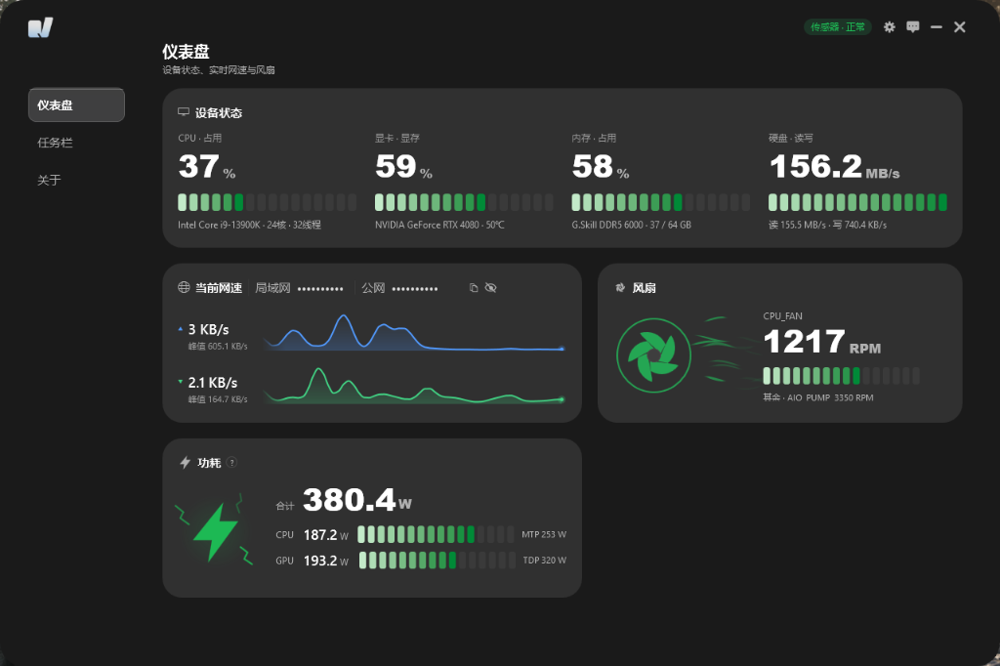

# QuadVitals

Windows 10 任务栏系统监控工具。以原生 DeskBand 常驻任务栏，实时监测 CPU、内存、CPU/GPU 温度、磁盘 I/O 与网络上下行速率；配套 WPF 仪表盘提供显卡、磁盘、功耗、主板风扇监控、网络历史曲线、任务栏元素编排、诊断反馈及应用内更新。

当前版本 **1.2.0**。正式目标平台为 **Windows 10 x64**；Windows 11 的系统限制与支持范围见下文。

## 功能

- **任务栏监控条**：支持 `bar`（分核逻辑处理器柱阵）、`pie`（扇形/渐变圆环）与 `text` 三类元素，可绑定内置硬件指标并自定义排序、启用状态与配色；右键菜单支持重启传感器、重启资源管理器、诊断信息、发送反馈、关于及退出。
- **仪表盘与设备状态**：四格设备状态卡展示 CPU、显卡、内存与系统盘占用；网络卡展示局域网 IPv4 与公网 IP（支持掩码切换与一键复制），并绘制最近 60 个采样点的独立上下行对数曲线（跨会话持久化）。
- **功耗监控**：展示 CPU 封装与 GPU 模块的实时合计功耗及分路负载（不含主板、硬盘、风扇与电源损耗）；合计读数按两路功耗上限之和的 70% 与 80% 触发黄色告警与红色危险着色，分母随硬件型号与 `TDP` / `MTP` 口径动态计算；支持「条形指示图」与「圆环」（外环 CPU、内环 GPU）两种样式，结合固件 MSR 与处理器规格表确定上限。
- **显卡与磁盘**：通过 NVML 采集 NVIDIA GPU 利用率、显存占用、温度、功耗与核心频率；支持系统盘容量占用与系统级或指定本地卷的磁盘 I/O 吞吐监测。
- **主板风扇**：通过主板 SuperIO 采集风扇及水泵转速，通道名称按主板型号表映射丝印标识（如 `CPU_FAN`、`AIO_PUMP`）；叶片转速与气流动效随实测转速动态调节并按正常、警告、危险三档连续变色；水泵通道固定为青色呼吸指示；风扇停转时显示 `0 RPM` 并触发告警；支持指定显示通道。
- **配置与热重载**：通用设置分为「启动设置」「外观设置」「性能设置」三组，集中管理开机自启、进度条样式（分段条/胶囊条）、电池供电暂停动画及四档渲染策略；网卡、采样周期与曲线样式于网速卡设置弹窗配置，保存后由 Agent 与 DeskBand 自动热重载。
- **反馈与诊断**：支持提交问题描述、附件与脱敏诊断日志；本地打包 ZIP 诊断包并上传至自建接收端点，上传失败保留本地包并支持就地重试或启动时自动补传。
- **应用内更新**：支持开启仪表盘时每日自检更新及关于页手动检查，读取发布清单 `latest.json` 下载安装包，通过文件大小与 SHA-256 强制校验后拉起安装向导。

## 系统要求

- Windows 10 x64（22H2 / 19045）
- 任务栏位于主显示器，未使用第三方任务栏替换工具
- CPU 温度、CPU 功耗、逐盘 I/O 与主板风扇采集依赖 PawnIO 2.2.0 或更高版本及管理员权限；安装包内置官方签名驱动安装器，目标机无需联网下载；传感器不可用时降级显示 `--`，其余指标正常采集

## Windows 支持说明

QuadVitals 的任务栏条基于 **DeskBand**（COM 工具栏对象）实现，依赖 Windows 10 Explorer 任务栏宿主。Windows 11 自 21H2 起移除了 DeskBand 接口，因此**任务栏条在 Windows 11 原生任务栏上无法显示**，属于操作系统架构限制而非安装失败。

| 功能模块 | Windows 10 | Windows 11 |
|---|---|---|
| 任务栏监控条（DeskBand） | 支持 | **不支持**，系统无 DeskBand 宿主 |
| 托盘 Agent 与传感器采集 | 支持 | 支持 |
| WPF 仪表盘与配置管理 | 支持 | 支持 |
| CPU / 内存 / 网络 / 磁盘 | 支持 | 支持；无 NVIDIA 驱动时 GPU 显示 `--` |
| CPU 温度 / 功耗 / 主板风扇 | 支持（需提权与驱动） | 取决于硬件与驱动；异常时降级显示 `--` |
| 安装、卸载与应用内更新 | 支持 | 支持 |

结论：

- Windows 10 为完整支持平台，任务栏条与仪表盘功能均完整可用。
- Windows 11 以「系统托盘 + WPF 仪表盘」模式运行，安装后无需勾选任务栏工具栏，请通过托盘菜单打开仪表盘。
- 若需在 Windows 11 实现桌面常驻，需改用悬浮窗或独立宿主，当前版本未提供该形态。

## 安装

从 [Releases](https://github.com/enosawauno/QuadVitals/releases) 下载 `QuadVitals-Setup-<版本>.exe` 并运行安装向导。

- 程序安装至 `%LOCALAPPDATA%\QuadVitals`，目录写入无需管理员权限。
- 安装过程请求一次管理员权限，用于准备传感器驱动与创建登录计划任务：若目标机已存在 2.2.0 或更高版本 PawnIO 则直接复用，否则离线安装内置的官方签名版本；若驱动返回需重启状态码，完成页将明确提示且不自动重启系统。卸载 QuadVitals 时保留共用 PawnIO 驱动。
- Windows 10：安装完成后，右键任务栏 → **工具栏** → 勾选 **QuadVitals**。若系统提示「工具栏与此版本 Windows 不兼容」，选择「是」即可加载。
- Windows 11：跳过任务栏工具栏勾选步骤，通过托盘菜单打开仪表盘。
- 卸载可通过系统「设置 → 应用」或安装目录中的 `QuadVitals-Uninstall.exe` 执行。卸载时将重启资源管理器以释放已加载的任务栏组件并清理安装目录；仍被系统占用的文件将注册至下次重启后删除。

安装器支持 `/S` 静默参数；命令行脚本 `scripts\install.ps1` 支持 `-InstallDir`、`-Task`、`-NoTask`、`-NoStart` 参数。

## 使用

- **任务栏监控条**：悬停显示内存用量、温度来源、当前网卡及快照更新时间；右键菜单提供重启传感器、重启资源管理器、诊断信息、发送反馈、关于及退出；双击打开仪表盘，若实例已开启则激活已有窗口，不重复创建实例。
- **仪表盘布局**：左侧导航切换「仪表盘」「任务栏」「关于」页面；标题栏集成「传感器状态」芯片、「通用设置」齿轮与「反馈」气泡入口；设备状态、网速、功耗与风扇卡片右上角均提供就地设置入口。
- **传感器状态面板**：点击标题栏状态芯片可查看当前权限与最近采样时间，并提供「启动传感器」或「重启传感器」操作，以管理员权限重建 Agent 进程及登录计划任务；启动成功后弹窗自动关闭并重置各卡片会话状态。若实例未提权，面板将明确提示受限原因并提供提权重启入口。运行期单项指标持续缺失时，看门狗将按退避策略触发自动进程替换（单帧抖动不触发）。
- **配置热重载**：修改配置后写入 `%APPDATA%\QuadVitals\settings.json`，Agent 与 DeskBand 自动热重载；当任务栏监控条总宽度变化时，需重启资源管理器或重新勾选工具栏以应用新尺寸。
- **渲染策略与动效**：通用设置「渲染策略」提供四档模式：`全局重绘`（默认，窗口失焦后仍持续渲染）、`悬停时播放动画`（仅风扇与功耗卡需指针悬停触发逐帧动画）、`失焦停止动画`、`全屏停止动画`。所有逐帧动画（风扇叶片与气流、水泵光晕、功耗电弧、磁盘走马灯、编辑态抖动）均受该全局策略统一约束；启用 `全局重绘` 会增加 GPU 与 CPU 开销。RDP 会话、WPF Tier 0 软件渲染及「电池供电暂停动画」具有更高环境优先级。
- **风扇与功耗设置**：风扇设置选择目标监控通道；功耗设置切换 CPU 功耗上限口径（`TDP` / `MTP`）及指示样式（条形指示图 / 圆环）。

## 排障

- **温度显示** `--`：温度读取依赖管理员权限与传感器驱动。若登录计划任务被禁用或 Agent 以普通权限启动，温度与主板风扇将持续显示 `--`，仪表盘提示「未提权」。请在标题栏传感器状态面板查看权限状态并点击「重启传感器」，以管理员权限重建进程与计划任务。若提示「温度读取失败」，通常为传感器会话异常，可通过同入口重建恢复；虚拟机环境缺少硬件温度传感器时显示 `--` 属预期行为。
- **风扇显示** `--` **或** `0 RPM`：风扇转速采集自主板 SuperIO，通道名称按主板型号表映射，未登记型号回退为「通道 N」。若出现读取失败或无通道提示，请排查是否与其他硬件监控或灯控软件（如 HWiNFO、AIDA64、FanControl、Armoury Crate）并发访问 SuperIO 寄存器冲突；必要时退出冲突软件后重启传感器。灯控软件内配置的通常为曲线目标占空比或目标转速，与硬件转速计实测读数存在小幅偏差及随负载浮动属正常现象。
- **温度与风扇同时短暂显示** `--`：两者共享同一次 LHM 传感器采样周期（5 秒采样、12 秒有效期）。高负载下若单次采样超时，两项将同步短暂降级为 `--`，待后续采样恢复后自动刷新；系统将双项同时失效判定为采样滞后（30 秒窗口），不会因短暂波动误触发进程替换。
- **登录后持续缺失 CPU 温度、功耗与风扇**：首次采集失败时，采集线程于 20 秒后尝试重开 LHM 会话，连续 60 秒无有效温度时请求替换进程；已正常采集过的会话发生持续故障仍按 10 分钟阈值触发。自动进程替换仅对已提权实例生效，受每小时一次冷却限制，且不依赖仪表盘开启。若安全软件持续拦截驱动加载，自动重启无法恢复采集。
- **提示安装或更新 PawnIO**：新版采集链已弃用旧 WinRing0 驱动。运行新版 QuadVitals 安装向导即可部署内置 PawnIO 驱动；采用免安装目录部署时，须手动安装 PawnIO 2.2.0 或更新版本后以管理员权限重启传感器。驱动缺失时系统不执行无效的循环重启。
- **任务栏监控条未显示**：Windows 10 下右键任务栏 → **工具栏** → 勾选 **QuadVitals**（Explorer 重启后需重新勾选或通过右键菜单刷新）；Windows 11 原生任务栏不提供 DeskBand 宿主，该表现属系统限制。
- **远程桌面或软件渲染下动画静止**：在 RDP 会话或 WPF Tier 0 环境下，系统自动停用逐帧动画以降低渲染开销，数值采样与历史曲线仍按设定周期刷新，属于预期降级行为。
- **诊断日志**：通过托盘或任务栏右键菜单打开「诊断信息」，可查看当前快照缺失项、采样周期与日志路径；传感器诊断日志写入 `%APPDATA%\QuadVitals\agent-temp.log`。

## 隐私与网络

- 硬件监控指标仅通过本机共享内存（`Local\QuadVitals.Metrics.v1`）传递，不经网络传输。
- 除以下四类明确触发的网络请求外，程序不发起任何外部网络连接：
  - **反馈上传**：用户主动提交反馈时
  - **公网 IP 查询**：仅仪表盘加载及后台定时查询公网 IP 用于界面展示，失败显示 `--`
  - **应用内更新**：打开仪表盘时每日自检一次或手动检查时拉取 `latest.json` 及安装包，校验文件大小与 SHA-256
  - **处理器规格表同步**：设置窗口启动时拉取静态规格 JSON（7 天节流），用于匹配 CPU 功耗上限口径，失败静默回退至内嵌基线表
- 反馈诊断包默认对 `%USERPROFILE%`、`%APPDATA%` 与 `%COMPUTERNAME%` 及本机路径执行脱敏替换；关闭「附带诊断日志」时不采集环境与运行摘要。
- 不采集行为遥测，不上传崩溃转储。

## 开发

构建、测试与代码结构见 [CONTRIBUTING.md](CONTRIBUTING.md)。

## 许可证

QuadVitals 采用 [PolyForm Noncommercial License 1.0.0](LICENSE)（source-available 许可，非 OSI 定义的开源许可）：源码公开，允许个人学习、研究与修改，**禁止任何商业用途**；商业授权需另行取得。中文要点见 [LICENSE.zh.md](LICENSE.zh.md)。

随附第三方组件及许可见 [THIRD-PARTY-NOTICES.txt](THIRD-PARTY-NOTICES.txt)：

- LibreHardwareMonitorLib 0.9.6（MPL 2.0）
- HidSharp 2.6.4（Apache 2.0）
- BlackSharp.Core 1.0.7 / DiskInfoToolkit 1.1.2 / RAMSPDToolkit-NDD 1.4.2（MPL 2.0）
- Microsoft 运行时组件（MIT）
- PawnIO 2.2.0 官方签名安装器（原样分发）
