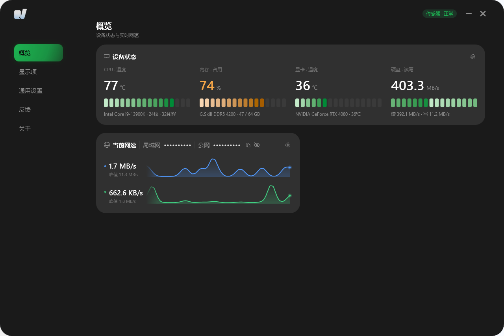

# QuadVitals

Windows 10 任务栏系统监控工具。以原生 DeskBand 常驻任务栏，显示 CPU、内存、CPU/GPU 温度与网络上下行；配套 WPF 仪表盘提供显卡、磁盘、网络历史、显示项编辑、反馈与应用内更新。

当前版本 **0.9.7**。正式目标平台为 **Windows 10 x64**；Windows 11 的系统限制与可用功能见下文。

## 功能

- **任务栏监控条**：CPU 占用、内存占用、CPU/GPU 温度、网络上下行；元素可增删、排序、配色，柱图按逻辑处理器分核显示。
- **仪表盘**：设备状态四格（CPU / 显卡 / 内存 / 磁盘），网络卡显示局域网与公网 IP、上下行曲线；支持指标切换、分段/胶囊指示器、深色主题。
- **网络**：自动聚合物理网卡，也可指定网卡；上下行曲线保留最近 60 个采样点，跨次启动继续绘制。
- **显卡与磁盘**：NVIDIA 利用率、显存、温度、功耗、频率；系统盘容量与读写吞吐。
- **风扇**：概览页风扇卡显示主板风扇转速与气流，通道按主板丝印命名（`CPU_FAN` / `AIO_PUMP` 等）；动画速率随转速变化，按正常、警告、危险三档连续变色；水泵固定为青色并带呼吸光晕；风扇停转时显示 `0 RPM` 并使用告警色。卡片设置菜单可选择显示通道，动效支持悬停播放或常驻动画。
- **设置**：网卡、刷新间隔、曲线样式、元素布局与颜色、风扇通道与动效、电池模式下暂停动画；修改后热重载，无需重启 Agent。
- **反馈**：仪表盘内提交问题与附件，生成脱敏诊断包；先生成本地 zip，再上传至自建服务。
- **应用内更新**：检查发布清单、下载安装包、校验 SHA-256 后拉起安装向导。

## 系统要求

- Windows 10 x64（22H2 / 19045）
- 任务栏位于主屏，未使用第三方任务栏替换工具
- 温度读取需要管理员权限加载传感器驱动；无权限时显示 `--`，其余指标不受影响

## Windows 支持说明

QuadVitals 的任务栏条为 **DeskBand**（COM 工具栏），依赖 Windows 10 的 Explorer 任务栏。Windows 11 从 21H2 起移除 DeskBand 接口，因此**任务栏条在 Win11 原生任务栏上不会显示**，该现象并非安装失败。

| 功能 | Windows 10 | Windows 11 |
|---|---|---|
| 任务栏监控条 | 支持 | **不显示**，系统不提供 DeskBand 宿主 |
| 托盘 Agent | 支持 | 可用 |
| 仪表盘与设置 | 支持 | 可用 |
| CPU / 内存 / 网络 / 磁盘 | 支持 | 可用；无 NVIDIA 显卡时 GPU 显示 `--` |
| CPU 温度 | 支持（需管理员） | 取决于硬件与驱动；读取失败时显示 `--` |
| 安装、卸载、应用内更新 | 支持 | 按相同流程使用 |

结论：

- Windows 10 为正式支持平台，任务栏条与仪表盘完整可用。
- Windows 11 不提供任务栏常驻，以“托盘 + 仪表盘”方式运行。
- 在 Windows 11 上安装后避免重复勾选任务栏工具栏；通过托盘菜单打开仪表盘。
- 如需在 Windows 11 实现任务栏常驻，需改用悬浮窗或独立启动器宿主，当前版本未提供。

## 安装

从 [Releases](https://github.com/enosawauno/QuadVitals/releases) 下载 `QuadVitals-Setup-<版本>.exe` 并运行。

- 安装至 `%LOCALAPPDATA%\QuadVitals`，写入文件无需管理员权限。
- 首次安装会请求一次管理员权限，用于创建登录计划任务，使 Agent 以最高权限启动并读取温度。
- Windows 10：安装完成后，右键任务栏 → **工具栏** → 勾选 **QuadVitals**。若提示“工具栏与此版本 Windows 不兼容”，选择“是”。
- Windows 11：任务栏不提供该工具栏条目，跳过此步骤，通过托盘菜单打开仪表盘。
- 卸载可通过“设置 → 应用”或安装目录中的 `QuadVitals-Uninstall.exe`。

安装器支持 `/S` 静默模式；`scripts\install.ps1` 支持 `-InstallDir`、`-Task`、`-NoTask`、`-NoStart`。

## 使用

- 任务栏条：悬停查看内存、温度来源、网卡与更新时间；右键打开设置、立即刷新、关于或隐藏；双击打开仪表盘。
- 仪表盘：左侧导航进入概览、显示项与关于；标题栏右侧齿轮打开通用设置，气泡打开反馈；设备状态卡右上角齿轮切换指示器与四格指标。
- 传感器状态：点击标题栏“传感器 · 正常”芯片打开面板，可执行“重启传感器”；游戏或驱动重置后温度、显卡数据不可用时，可通过该操作切换 Agent 进程重新读取。单项数据持续缺失时自动重启，单帧抖动不触发，失败按间隔重试。
- 设置修改会写入 `%APPDATA%\QuadVitals\settings.json`，Agent 与任务栏条自动热重载；任务栏条宽度变化后需重新勾选工具栏。
- 风扇卡：标题齿轮可选择显示通道，也可切换“悬停播放”与“常驻动画”；常驻动画持续占用 GPU 与 CPU，切换前显示实测占用。
- 电池供电时默认暂停仪表盘动画；如需在电池供电下继续播放，可在通用设置中取消“电池模式下暂停动画”。

## 排障

- **温度显示 `--`**：温度读取需要管理员权限加载传感器驱动。首次安装会请求一次提权并创建登录计划任务；若任务被禁用或 Agent 以普通权限启动，温度将持续显示 `--`，其余指标不受影响。概览页 CPU 温度卡会显示原因：`未提权，读不到温度` 表示 Agent 以普通权限启动，`温度读取失败` 表示传感器会话失效；两种情况均可在标题栏传感器面板中执行“重启传感器”。虚拟机内没有可读的 CPU 温度传感器，同样属于预期显示。
- **风扇显示 `--` 或停转**：风扇转速来自主板 SuperIO。通道名（`CPU_FAN` / `AIO_PUMP` 等）按板型表映射，未登记板型显示为“通道 N”。若卡片显示“传感器未提权”，先通过计划任务重新启动 Agent；显示“风扇数据读取失败”表示 LHM 会话失效；显示“未读取到主板风扇”表示未检测到通道。仍未读取时，注意其他硬件监控或灯控软件（HWiNFO、AIDA64、FanControl、Armoury Crate 等）会访问同一 SuperIO 芯片，并发访问可能导致读数归零；必要时退出上述软件并重启传感器。灯控软件里写的最高转速是目标值，卡片显示的是转速计读数，两者相差几个百分点属于正常范围；转速会随温度与负载在曲线内浮动。
- **任务栏条未显示**：右键任务栏 → 工具栏 → 勾选 QuadVitals；Explorer 重启后需重新勾选。Windows 11 原生任务栏不提供 DeskBand 宿主，任务栏条不会显示，属于系统限制。
- **远程桌面中动画停止**：RDP 会话或 WPF Tier 0（无硬件加速）下自动停止逐帧动画，风扇、气流与分段条过渡静止，数值与网络曲线仍按刷新周期更新；属于预期行为。
- **诊断信息**：托盘菜单“诊断信息…”显示当前快照的缺失指标、采样周期与日志路径；风扇相关事件写入 `%APPDATA%\QuadVitals\agent-temp.log`。

## 隐私与网络

- 指标仅通过本机共享内存传递，不通过网络传输。
- Agent 不主动联网；除以下三类请求外无网络访问：
  - 反馈上传（用户主动提交）
  - 公网 IP 查询（仅仪表盘展示，失败显示 `--`）
  - 更新清单与安装包下载（必须通过 SHA-256 校验）
- 反馈包默认附带脱敏诊断日志；用户目录、AppData 与计算机名会替换为占位符。
- 不采集遥测，不上传崩溃转储。

## 开发

构建、测试与目录结构见 [CONTRIBUTING.md](CONTRIBUTING.md)。

## 许可证

QuadVitals 使用 [PolyForm Noncommercial License 1.0.0](LICENSE)：源码公开，可阅读、修改，并可用于个人学习与研究；**禁止任何商业用途**，商用需单独授权。

该许可为 **source-available** 许可，并非 OSI 定义的开源许可：其限制商业使用，因此不符合开源定义。中文要点见 [LICENSE.zh.md](LICENSE.zh.md)。

第三方组件与许可全文见 [THIRD-PARTY-NOTICES.txt](THIRD-PARTY-NOTICES.txt)：

- LibreHardwareMonitorLib 0.9.2（MPL 2.0）
- HidSharp 2.1.0（Apache 2.0）
